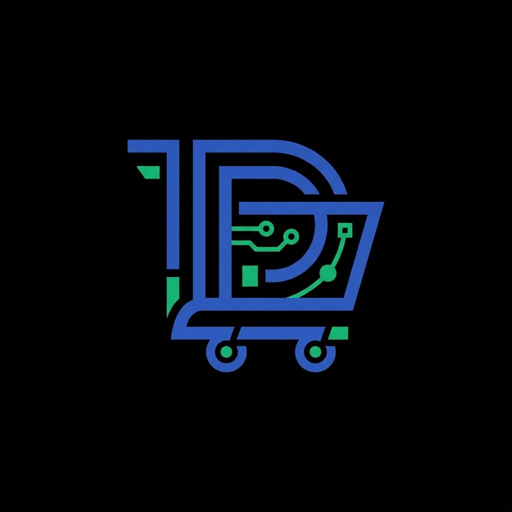

<p align="center">
  
</p>

<h1 align="center">DevCart Gemini Watermark Tool</h1>

<p align="center">
  <b>Official Free & Open-Source AI Image & Video Watermark Removal Suite</b><br>
  <i>Built with ❤️ in India 🇮🇳 by <b>DevCart Technologies</b> • Lead Developer: <b>Vivek Dalvi</b></i>
</p>

<p align="center">
  <a href="https://geminiwm.devcart-technologies.in/"></a>
  <a href="https://github.com/vivek-dalvi/gemini-watermark-tool.git"></a>
  <a href="https://devcart-technologies.in/"></a>
  <a href="LICENSE"></a>
  <a href="https://www.instagram.com/devcart_technologies/"></a>
  <a href="https://www.linkedin.com/in/vivek-dalvi-65923940b"></a>
  <a href="https://www.youtube.com/@devcart-technologies"></a>
</p>

---

## 1. Overview & Open Source Philosophy

**DevCart Gemini Watermark Tool** is a 100% free, open-source software suite engineered with pride in **India 🇮🇳 ❤️** by **DevCart Technologies** and developed by **Vivek Dalvi**. It is designed to automatically detect and eliminate translucent watermark logos from images and videos generated by Google Gemini AI (0.5K, 1K, 2K, 4K) and Google Veo.

Unlike conventional online watermark tools that use destructive AI inpainting or blur passes (which destroy details and hallucinate fake pixels), this tool performs exact **mathematical inverse alpha channel recovery**. By solving the original compositing equation in reverse ($C_{\text{orig}} = \frac{C_{\text{wm}} - \alpha \cdot C_{\text{src}}}{1 - \alpha}$), the software restores the underlying original pixel values with **zero quality loss**.

- **Live Web Application**: [https://geminiwm.devcart-technologies.in/] https://geminiwm.devcart-technologies.in
- **Repository**: [https://github.com/vivek-dalvi/gemini-watermark-tool.git](https://github.com/vivek-dalvi/gemini-watermark-tool.git)
- **License**: MIT License (Permissive, 100% Free for personal and commercial use)
- **Lead Developer**: Vivek Dalvi ([LinkedIn Profile](https://www.linkedin.com/in/vivek-dalvi-65923940b) | [vivekdalvi147@gmail.com](mailto:vivekdalvi147@gmail.com))
- **Organization**: DevCart Technologies ([Instagram](https://www.instagram.com/devcart_technologies/) | [YouTube](https://www.youtube.com/@devcart-technologies) | [Website](https://devcart-technologies.in/))

---

## 2. Real-World Comparison Examples

Here are actual Gemini AI generated images processed through the DevCart Gemini Watermark Tool showing 100% loss-free watermark removal:

### Example 1: Full-Resolution Gemini AI Output

| Watermarked Original Input | Clean Processed Result (Zero Quality Loss) |
| :---: | :---: |
|  |  |
| *Watermark applied in bottom-right corner* | *Watermark fully removed with exact original pixel restoration* |

---

### Example 2: Complex Detail Gemini Output

| Watermarked Original Input | Clean Processed Result (Zero Quality Loss) |
| :---: | :---: |
|  |  |
| *Translucent logo over complex background* | *100% clean image output with mathematical precision* |

---

## 3. Key Features

- **Reverse Alpha Blending Engine**: Mathematically restores authentic underlying pixels instead of smudging or blurring.
- **100% Client-Side Privacy**: All processing executes strictly inside local browser memory via HTML5 Canvas, WebAssembly, and Web Workers. Zero bytes are uploaded to remote servers.
- **Image & Video Support**:
  - **Images**: PNG, JPG, WebP across 512px (0.5K), 1024px (1K), 2048px (2K), and 4096px (4K) resolutions.
  - **Videos**: MP4, WebM, and MOV video clips with frame-by-frame denoise and original audio stream preservation.
- **Interactive UI with View Modes**:
  - **Split Slider**: Drag handle to dynamically compare before and after.
  - **Side-by-Side**: Two full-resolution panes for comparative inspection.
  - **Flip Toggle**: One-click quick toggle between original and processed output.
- **Multiple Theme Options**:
  - **Dark Emerald**: Signature cyberpunk emerald dark mode (Default).
  - **Midnight OLED**: Ultra-deep pitch-black `#000000` with vibrant neon highlights.
  - **Clean Light Studio**: High-contrast, clean minimalist light theme.
- **Multiple Deployment Entrypoints**:
  - **Web Application Portal**: Modern drag-and-drop web UI.
  - **Tampermonkey Userscript**: Cleans downloads and previews directly inside `gemini.google.com`.
  - **Chrome Extension (Manifest V3)**: Dedicated browser popup extension.
  - **Node.js SDK & CLI**: Batch CLI commands for servers, automation, and desktop scripts.

---

## 3. How to Deploy (Step-by-Step Guide)

You can run and deploy the DevCart Gemini Watermark Tool across several environments:

### Method A: Local Development / Node.js
```bash
# 1. Clone the official repository
git clone https://github.com/vivek-dalvi/gemini-watermark-tool.git
cd gemini-watermark-tool

# 2. Install dependencies
npm install

# 3. Start local development server
npm run dev

# 4. Open in browser
# Navigate to http://localhost:4173
```

### Method B: Production Build & Local Server
```bash
# Build the production distribution
npm run build

# Start production server on port 3000
npm start
```

### Method C: Docker Deployment
A ready-to-use containerized deployment:

1. Create a `Dockerfile` in the project root (or use the existing one):
```dockerfile
FROM node:20-alpine AS builder
WORKDIR /app
COPY package*.json ./
RUN npm install
COPY . .
RUN npm run build

FROM node:20-alpine AS runner
WORKDIR /app
COPY --from=builder /app ./
EXPOSE 3000
ENV PORT=3000
CMD ["npm", "start"]
```

2. Build and run the Docker container:
```bash
# Build the image
docker build -t devcart/gemini-watermark-tool .

# Run container on port 3000
docker run -d -p 3000:3000 --name gemini-watermark-tool devcart/gemini-watermark-tool
```

### Method D: Deploy to Google Cloud Run / AWS / VPS
Because the web app compiles to static HTML/JS/CSS assets with a lightweight Node.js server (`server.js` or `build.js`):
1. **Google Cloud Run**:
   ```bash
   gcloud run deploy gemini-watermark-tool --source . --port 3000 --allow-unauthenticated
   ```
2. **VPS (Ubuntu/Debian) with PM2**:
   ```bash
   git clone https://github.com/vivek-dalvi/gemini-watermark-tool.git
   cd gemini-watermark-tool
   npm install
   npm run build
   npm install -g pm2
   pm2 start "npm start" --name "gemini-watermark-tool"
   ```

### Method F: Deploy to Hugging Face Spaces (Recommended)
To prevent **404 Not Found** errors and ensure all code (including `app.js`) works:

#### Option 1: Docker (Best for HF)
1. Create a new Space on Hugging Face.
2. Select **Docker** as the SDK.
3. The repo already contains the necessary `package.json` and build scripts. Hugging Face will automatically use the `Dockerfile` instructions (Method C) to build and serve the app.
4. Your tool will be live with all features working perfectly.

#### Option 2: Static Space
1. Run `npm run build` locally on your machine.
2. Create a new **Static** Space on Hugging Face.
3. Upload **ONLY the contents of the `dist/` folder** to the root of your Space.
4. Ensure `index.html`, `app.js`, and the `models/` folder are at the top level.

---

## 4. Browser Integrations

### Tampermonkey Userscript (Auto-clean on Gemini Web App)
1. Install [Tampermonkey](https://www.tampermonkey.net/) in Chrome, Edge, Brave, or Firefox.
2. Click to install the script from your deployed site: `userscript/gemini-watermark-remover.user.js` or from the repository's `dist/userscript/`.
3. Open [https://gemini.google.com/app](https://gemini.google.com/app) — generated images will be cleaned automatically!

### Chrome Extension (Manifest V3)
1. Run `npm run build`.
2. Open Chrome and navigate to `chrome://extensions/`.
3. Enable **Developer mode** in the upper-right corner.
4. Click **Load unpacked** and select the `dist/extension` folder.

---

## 5. Technical Math & How It Works

Google Gemini blends a watermark asset $C_{\text{src}}$ over an image $C_{\text{orig}}$ with alpha map $\alpha$:
$$C_{\text{wm}} = \alpha \cdot C_{\text{src}} + (1 - \alpha) \cdot C_{\text{orig}}$$

The DevCart Gemini Watermark Tool extracts the exact $C_{\text{src}}$ color and alpha profile $\alpha$ for Gemini's 48x48 and 96x96 watermark assets and algebraically inverts the equation:
$$C_{\text{orig}} = \frac{C_{\text{wm}} - \alpha \cdot C_{\text{src}}}{1 - \alpha}$$

This analytical solution guarantees 100% pixel fidelity with zero AI hallucination, smearing, or color distortion.

---

## 6. Privacy & Security Guarantee

- **Zero Server Uploads**: Processing occurs 100% inside your local device's memory.
- **Zero Telemetry**: No cookies, no analytics beacons, no tracking.
- **Full Ownership**: You maintain 100% rights and copyright over all your processed files.

---

## 7. Developer & Attribution

- **Organization**: **DevCart Technologies** ([https://devcart-technologies.in/](https://devcart-technologies.in/))
- **Lead Developer**: **Vivek Dalvi** ([vivekdalvi147@gmail.com](mailto:vivekdalvi147@gmail.com))
- **Official GitHub**: [https://github.com/vivek-dalvi/gemini-watermark-tool.git](https://github.com/vivek-dalvi/gemini-watermark-tool.git)
- **License**: MIT License

---

## 8. Troubleshooting & FAQs

| Issue | Potential Cause | Solution |
| :--- | :--- | :--- |
| **"Original image is unavailable"** | Page refreshed mid-interception on Gemini web app. | Refresh `gemini.google.com` and trigger download again. |
| **Watermark faintly visible** | Unusual aspect ratio or non-standard token resolution. | Enable **Best Effort Mode (Force)** in the actions panel. |
| **Extension popup won't load** | Developer mode disabled in Chrome. | Ensure Developer mode is toggled ON in `chrome://extensions/`. |
| **CLI missing optional decoder** | Native image dependencies omitted. | Run `npm install sharp` or use `--decoder synthetic`. |

---

## 9. Contact, Support & Contributions

- **Brand**: **DevCart Technologies**
- **Lead Developer**: **Vivek Dalvi**
- **Personal / Developer Email**: [vivekdalvi147@gmail.com](mailto:vivekdalvi147@gmail.com)
- **Official Inquiries**: [info@devcart-technologies.in](mailto:info@devcart-technologies.in)
- **Website**: [https://devcart-technologies.in/](https://devcart-technologies.in/)
- **GitHub Repository**: [https://github.com/vivek-dalvi/gemini-watermark-tool.git](https://github.com/vivek-dalvi/gemini-watermark-tool.git)

Contributions, pull requests, and bug reports are welcome! If this tool helped you, please give it a ⭐ star on GitHub.

---

## 10. License & Legal Disclaimer

Distributed under the **MIT License**. Copyright (c) 2026 DevCart Technologies & Vivek Dalvi.

*Google, Gemini, and Veo are trademarks of Google LLC. This independent software project is developed by DevCart Technologies and is not affiliated with or endorsed by Google LLC.*

